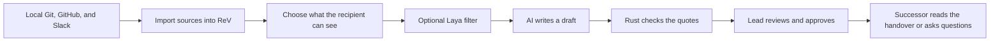

# How ReV works

ReV helps one engineer hand a project over to another. It reads project history, drafts a handover with quotes from the sources, and lets a person check the draft before sharing it.

## The flow in one picture

1. **Import.** Choose a local checkout, a GitHub repository, or Slack sources. A local checkout lets ReV read commits and project files from your computer. GitHub provides remote material such as pull requests and review comments. Slack can provide discussion and decisions that never made it into a commit. **Instant Demo** uses a bundled snapshot of public ReV commits and a prepared draft.
2. **Select sources.** Check the material the recipient can see. **Select all** works for runs with up to 500 sources. You confirm access and allow the selected text to go to your configured model before it writes a live draft.
3. **Filter with Laya.** When enabled, Laya runs locally in Python and checks commit messages and available change details. It can skip routine cleanup from the draft input. The review screen shows how many commits it skipped. If you see `Skipped 0 of 47`, all 47 evaluated commits stayed available to the draft writer.
4. **Generate and check the draft.** ReV asks your configured AI provider to write decisions, risks, open work, and next steps. Rust checks that each cited quote appears in the selected source. A **validated reference** confirms the quote exists. You still need to check what the draft claims about it. A commit that says a fix shipped, for example, supports asking the successor to verify it, while calling it unfinished would need more evidence.
5. **Review and share.** Expand a claim category to edit wording, exclude low-value claims, or flag something for clarification. You can set the successor email during Import. Approve the current version before exporting Markdown or sharing it with a successor. Changes to the approved draft or its source selection can require another review.

## What runs when you click Generate draft

| Tool | What it does |
| --- | --- |
| **React and Next.js** | Show the wizard, send the request, and display the draft and any errors. React handles the screens. Next.js serves them and forwards API requests. |
| **Node.js daemon** | A local background process that validates requests, coordinates imports and generation, and tracks run state. The browser app normally listens on port `3077` and the daemon on `3078`. |
| **PGlite** | A small PostgreSQL database embedded in the local app. It saves runs, selected sources, drafts, and review state under `.rev-data` by default. |
| **Python and Laya** | An optional local pre-filter for commit relevance. The Git history and imported source records stay available. |
| **Rust core** | Builds the model request, parses the reply, and checks citations. It also handles GitHub import and analysis jobs. |
| **Your model provider** | Writes the draft from the supplied evidence. ReV talks to OpenAI-compatible or Anthropic endpoints. The provider can be local or remote depending on your settings. |

Tree-sitter is part of the code analysis. It helps ReV name the functions and other code structures that changed, so a handover can say which part of a file changed.

## The other screens and tools

| Feature | What it means in practice |
| --- | --- |
| **Local projects** | Register a checkout so the daemon can scan it and take snapshots. Pick that checkout under **Git source** when you want to import it into a handover. |
| **Ownership and churn** | A local Git analysis that uses who last changed the lines and how many lines changed in 90 days. It highlights areas where knowledge may be concentrated in one person. |
| **Gaps and departure interview** | Turn missing handover details into questions for the outgoing engineer. Their answers can become attributed evidence after review. |
| **Evidence graph and divergence** | Show connections between sources and claims. Divergence proposes possible contradictions for a person to check. |
| **Successor view** | Read an approved handover and ask questions about its evidence. |
| **VS Code extension** | Opens a ReV panel and provides commands for workspace registration, scanning, and creating, approving, or exporting a handover. It talks to the local daemon. |
| **MCP** | Gives compatible AI clients tools for admin, departing-engineer, and successor workflows. Think of it as another way to ask ReV to do a task. |
| **Supabase and team sync** | Optional shared storage and team features. Local runs are saved in PGlite. Cloud sync depends on configuration and consent. |

## Where to look in the code

| I want to understand… | Start here |
| --- | --- |
| The browser wizard | [HandoverWizard.tsx](../src/components/admin/HandoverWizard.tsx) |
| How requests go from the browser to ReV | [Runs API](../src/app/api/runs/route.ts) and [daemon entry](../src/daemon/entry.ts) |
| How a run changes from import to approval | [Handover service](../src/lib/server/service.ts) and [store](../src/lib/server/store.ts) |
| Local Git and Slack import | [Source import](../src/lib/server/sources.ts) |
| Laya's rules and model call | [Triage logic](../src/lib/server/laya-triage.ts) and [Python worker](../scripts/laya-triage.py) |
| Draft retries and citation checking | [Core bridge](../src/lib/server/core.ts) and [Rust core](../crates/rev-core/src/main.rs) |
| VS Code and MCP | [Extension entry](../editors/vscode/src/extension.ts) and [MCP server](../src/mcp/server.ts) |

## Try the flow yourself

- **Learn the screens.** Start **Instant Demo**, pick a few sample sources, generate a draft, review the quotes, and export it.
- **Try real data.** Start a live run, select your local checkout under **Git source**, import it, and pick a few commits. Generate a draft with your configured model and compare each claim with its quoted source.
- **If GitHub hits a rate limit.** Start a fresh import from the local checkout if you have it. Local Git can read the commit history without using the GitHub API.
- **If the model reply gets cut off.** The provider stopped before finishing the structured draft. ReV retries with a shorter reply request and may use smaller source excerpts. If the retry still fails, select fewer sources or switch models.

For startup commands, see the [README](../README.md#start-locally-development-checkpoint). For more about the local background process and permissions, see [Daemon lifecycle](DAEMON_LIFECYCLE.md) and [Security model](SECURITY_MODEL.md).
