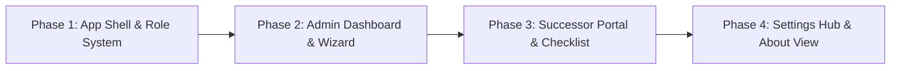

# ReV: Material 3 Expressive Role-Based UI Architecture & Implementation Plan

## Executive Overview

This plan transforms **ReV** from a single-page vertical form into a role-tailored software application following Google's **Material 3 Expressive** design system. 

It splits the experience into three distinct personas:
1. **Admin / Team Lead (Creator & Auditor)**: Configures integrations, discovers projects, runs a step-advancing handover creation wizard, reviews evidence, conducts interview question gap preparation, approves, and assigns the handover to a successor.
2. **Departing Teammate (Contributor & Interviewee)**: Accesses a dedicated departure workspace (`<DepartingWorkspace />`), reviews flagged architectural questions generated by the engine, provides evidence-backed explanations, and submits them as review answers for lead signoff.
3. **Successor / Onboarding Developer (Consumer & Operator)**: Views assigned handovers, works through an interactive Day-1 task checklist, reads the approved handover document, inspects verbatim citations in an evidence drawer, and queries the interactive Handover Assistant (`<HandoverAssistant />`) with exact citations.

It also introduces dedicated **Settings** (with live server persistence) and **About** workspaces, removing all environment-file editing and marketing copy clutter from the operational workflow.

---

## 1. Material 3 Expressive Design System Specifications

### 1.1 Color Tokens & Tonal Palette
All components leverage Material 3 tonal palettes with ReV's signature green aesthetic:

* **Primary (`#174a3d`)**: High-emphasis interactive elements, FABs, primary buttons.
* **On-Primary (`#ffffff`)**: Text and icons on primary containers.
* **Primary Container (`#d9ebda`)**: Active navigation tabs, active stepper badges, selected row fills.
* **On-Primary Container (`#0f352b`)**: High-contrast labels inside primary containers.
* **Surface Dim / Canvas (`#f5f7f2`)**: Background canvas for low-glare reading.
* **Surface Container (`#ffffff`)**: Elevated cards, wizard panels, modals.
* **Surface Container High (`#eaf1ec`)**: Interactive hover states, secondary chips, code block callouts.
* **Outline / Outline Variant (`#dbe5dd` / `#e1e9e1`)**: Card borders, dividers, subtle boundaries.
* **Semantic Tones**:
  * *Success/Valid*: `#1b633b` on container `#e6f4ea` (for verified citations).
  * *Warning/Uncertain*: `#805d1d` on container `#fff7e7` (for flagged claims/gaps).
  * *Error/Danger*: `#9b4639` on container `#fff0ed` (for deletions/rejections).

### 1.2 Expressive Shapes & Typography
* **Shapes**:
  * Action Buttons & Status Pills: Fully rounded pill shape (`border-radius: 9999px`).
  * Workspace Cards & Wizards: Expressive rounded containers (`border-radius: 20px` to `24px`).
  * Insets & Citation Callouts: Asymmetric cards (`border-radius: 4px 14px 14px 4px`).
* **Typography**:
  * Display Headings (`h1`, `h2`, `h3`): `'DM Serif Display', Georgia, serif`.
  * Controls, Labels, Inputs, Evidence: `'DM Sans', system-ui, sans-serif`.
  * Verbatim Quotes & Code: `'JetBrains Mono', 'Fira Code', monospace`.

### 1.3 Motion & Transitions
* Expressive easing curves: `cubic-bezier(0.2, 0.0, 0, 1.0)`.
* Step transitions: When moving from Step 1 to Step 2, the previous step smoothly slides out and the next step enters from the right with opacity fade, eliminating vertical layout jumping.
* Full respect for `prefers-reduced-motion: reduce`.

---

## 2. Information Architecture & Sitemap

```
┌──────────────────────────────────────────────────────────────────────────────────┐
│                             TOP NAVIGATION BAR                                   │
│  [R] ReV    Projects (Home)    |    Settings    |    About    |   [Role Switcher]    │
└──────────────────────────────────────────────────────────────────────────────────┘

ADMIN PORTAL
├── 1. Projects Dashboard (Home)
│     ├── Summary Metrics (Active handovers, scanned repos, pending reviews)
│     ├── Project Cards Grid (Repo name, branch, departing contributor, successor, status)
│     ├── Existing Project Detail View:
│     │     ├── Handover Timeline & Metadata
│     │     └── Full Markdown Viewer of approved handover
│     └── (+) Floating Action Button / Header Action ──► Launch Creation Wizard
├── 2. Creation Wizard (Screen-by-Screen Studio)
│     ├── Screen 1: Connect & Contributor Discovery (Auto-detected git, authors chips, Slack channels)
│     ├── Screen 2: Evidence Scope Feed (Dual-pane filterable activity feed, git commits & local docs)
│     ├── Screen 3: Review Canvas & Interview Review (Inline editable claims, verification pills, interview answer inclusions)
│     └── Screen 4: Publish & Assign (Select successor dev, target role, publish)
├── 3. Settings Hub
│     ├── Provider Config (OpenAI / Anthropic / Ollama base URL & model name)
│     ├── API Tokens (Model key, GitHub personal token, Slack client secrets)
│     └── Storage Mode (Local PGlite vs Cloud Supabase toggle)
└── 4. About & Documentation
      ├── Trust Model & Verification Guarantees
      └── System Architecture & Audit Information

DEPARTING TEAMMATE PORTAL
└── 1. Departure Workspace (`<DepartingWorkspace />`)
      ├── Handover Gaps Queue (Questions generated via `prepare_interview` comparing commits & docs)
      ├── Rich Answer Submission Form (`<DepartureInterview />`)
      └── Status Badges (Answered vs Open review answers)

DEVELOPER / SUCCESSOR PORTAL
├── 1. My Handovers (Home)
│     ├── Active Handover Overview & Metadata
│     ├── Interactive Day-1 Task Checklist
│     ├── Approved Handover Markdown Reader with Citations
│     └── Handover Assistant (`<HandoverAssistant />`) (Interactive cited Q&A powered by `/v1/runs/:id/ask`)
│     ├── Welcome Banner: "Ready for Day 1 on [Project Name]"
│     └── Assigned Project Cards (Assigned by, Handover date, Target role)
├── 2. Handover Portal (Active Project View)
│     ├── Interactive Day-1 Action Checklist (Checkboxes with real-time completion %)
│     ├── Formatted Handover Markdown Viewer
│     └── Interactive Citation Badges (Clicking opens slide-over evidence preview)
├── 3. Settings Placeholder (Preferences & profile)
└── 4. About & Guide (How to read citations and run verification)
```

---

## 3. Multi-Phase Implementation Roadmap



---

### Phase 1: App Shell, Navigation & Persona Switching

**Objective**: Build the top-level application layout, routing/tab state, role switching mechanism, and Material 3 Expressive theme tokens.

#### Deliverables:
1. **Application Shell (`src/components/AppShell.tsx`)**:
   - Modern top navigation bar with ReV brand mark.
   - Primary navigation tabs: `Projects`, `Settings`, `About`.
   - Role Switcher component in the top-right:
     `[ Switch Persona: 👑 Admin (Tech Lead) ⮂ 👤 Successor (Alex) ]`.
2. **Local Session / Role State (`src/lib/auth-context.tsx`)**:
   - Lightweight client state for role switching (`admin` vs `developer`), allowing instant local demonstration.
   - Persistence in `localStorage` so refreshing remembers the active role.
3. **Material 3 Expressive Theme Refresh (`src/app/globals.css`)**:
   - Refined tokens for surface containers, elevation shadows, asymmetric border radii, and fluid sliding animations for wizard transitions.

---

### Phase 2: Admin Dashboard & Screen-by-Screen Creation Wizard

**Objective**: Replace the cluttered single-page form with a clean Projects home screen and a dedicated multi-step creation studio where steps advance sequentially.

#### Deliverables:
1. **Projects Home Screen (`src/components/admin/ProjectList.tsx`)**:
   - Top metrics bar (Total projects, active handovers, pending approvals).
   - Project cards displaying repo path, departing engineer, target role, and status badge (`Draft`, `Under Review`, `Approved`, `Published`).
   - Prominent **"(+) Start Handover"** button.
   - Clicking an existing project navigates to **Project Detail View** with rendered Markdown and export options.
2. **Multi-Step Screen-Advancing Wizard (`src/components/admin/HandoverWizard.tsx`)**:
   - Replaces the current vertical stacking in `HandoverWorkspace.tsx`.
   - **Screen 1 (Connect)**:
     - Discovers local Git repository and lists recent committers as clickable profile chips.
     - Slack workspace status tile and channel selection checkboxes.
     - Primary button: **"Next: Select Evidence →"** (Smoothly unmounts Screen 1 and slides Screen 2 into view).
   - **Screen 2 (Evidence Scope Feed)**:
     - Dual-pane or tabbed activity feed (`All`, `Commits`, `Slack`).
     - Live counter of selected items.
     - Security guardrail box directly beside **"Generate Handover Draft →"**.
   - **Screen 3 (Review Canvas)**:
     - Formatted claim cards with inline editing, category tags, and verification badges.
     - Step action: **"Approve & Proceed to Assign →"**.
   - **Screen 4 (Publish & Assign)**:
     - Assign to onboarding developer by name or email.
     - Assign target role (e.g. *Senior Backend Engineer*).
     - Final **"Publish to Successor Portal"** action that marks the handover `published`.
   - Stepper header allows clicking back to previous steps without data loss.

---

### Phase 3: Successor / Onboarding Developer Portal

**Objective**: Create the dedicated consumption portal for the incoming engineer with interactive onboarding checklists and evidence drawers.

#### Deliverables:
1. **Developer Home Screen (`src/components/dev/DevDashboard.tsx`)**:
   - Personalized hero: *"Welcome, Alex! Here are your active handovers."*
   - Assigned project cards showing who handed it over (e.g. *Handed over by Maya Patel*) and priority tasks count.
2. **Interactive Day-1 Checklist (`src/components/dev/DayOneChecklist.tsx`)**:
   - Extracts Day 1 follow-ups from the handover into interactive checklist items with a completion progress bar.
   - Saves checkbox states to local state/PGlite database.
3. **Evidence-Linked Markdown Viewer (`src/components/dev/HandoverReader.tsx`)**:
   - Typeset Markdown reader with clean typography, code block syntax highlighting, and clear section dividers.
   - **Interactive Citation Badges**:
     - Whenever a claim has a citation (e.g. `[git: c8bc494]` or `[slack: #billing]`), it renders as an interactive pill.
     - Clicking the badge opens a **Slide-Over Evidence Drawer** displaying the exact verbatim quote, author, timestamp, and link to the source.

---

### Phase 4: Settings Hub & About Documentation Workspace

**Objective**: Move configuration out of `.env` files into a dedicated Settings tab, and move marketing/trust explanations into a clean About workspace.

#### Deliverables:
1. **Settings Hub (`src/components/settings/SettingsView.tsx`)**:
   - **Model Provider Section**: Radio selector for `OpenAI`, `Anthropic`, or `Local (Ollama/vLLM)`. Base URL, Model Name, and API Key input with masking.
   - **Connector Credentials**: GitHub Personal Access Token status, Slack PKCE app configuration.
   - **Storage Engine**: Toggle between Local Embedded PGlite and Remote Supabase/PostgreSQL.
   - Save button with immediate validation feedback.
2. **About / Help Workspace (`src/components/about/AboutView.tsx`)**:
   - **Verification Philosophy**: Detailed explanation of ReV's "A source, not a guess" principle.
   - **Security & Privacy Boundaries**: Local-only execution, loopback binding, and data retention rules.
   - **Citation Engine Details**: How verbatim substring matching works in `rev-core`.

---

## 4. Verification & Quality Gates

Each phase will be verified against the test harness:
1. **Component Type Safety**: `npx --no-install tsc --noEmit` must pass with 0 errors after each phase.
2. **Playwright E2E Tests**:
   - Admin flow: Project selection $\rightarrow$ Wizard Screen 1 $\rightarrow$ Screen 2 $\rightarrow$ Screen 3 $\rightarrow$ Screen 4 Publish.
   - Successor flow: Role switch to Developer $\rightarrow$ Open assigned handover $\rightarrow$ Check Day-1 task $\rightarrow$ Click citation badge to verify evidence drawer.
   - Responsive check: Verified at 320px, 390px, and desktop widths.
3. **Core Engine**: `cargo test --workspace` passes all 14 engine tests.

